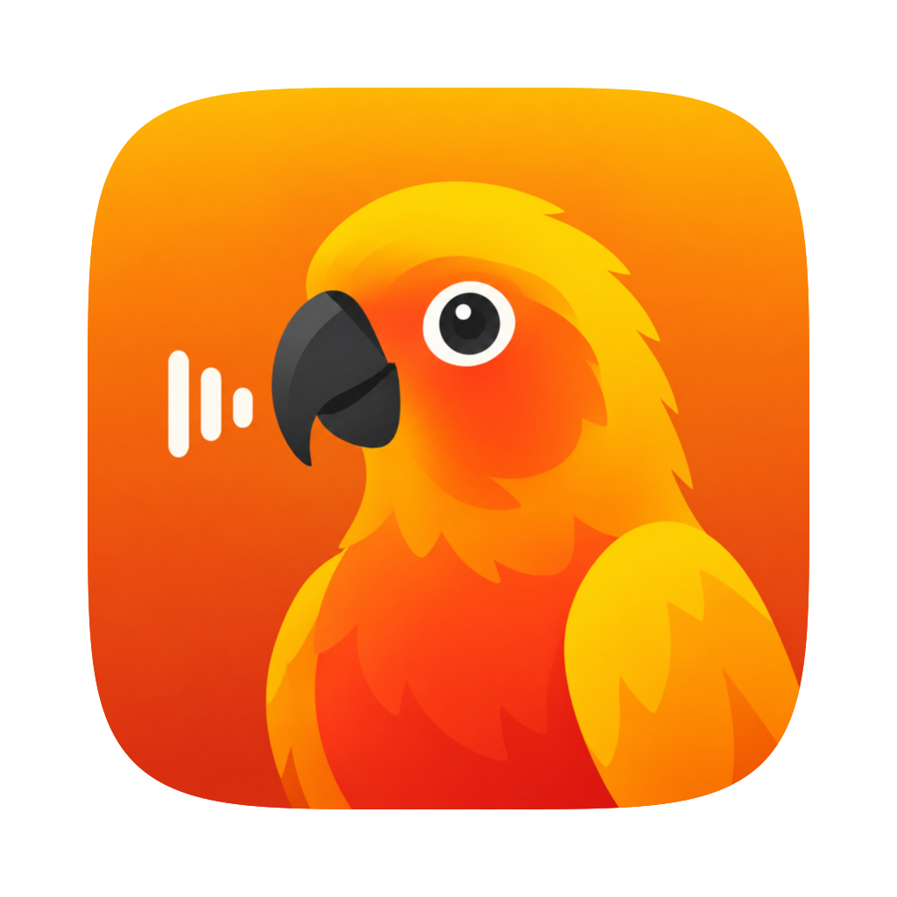

<p align="center">
  
</p>

<h1 align="center">Conure</h1>

<p align="center"><strong>Local-first audio &amp; video transcription for Apple Silicon Macs.</strong></p>

<p align="center">
  <a href="https://github.com/nethbotheju/Conure/actions/workflows/ci.yml"></a>
  <a href="https://github.com/nethbotheju/Conure/releases"></a>
  <a href="LICENSE"></a>
</p>

NVIDIA's Parakeet ASR running entirely on-device (CoreML / Neural Engine), with speaker diarization, a queue-driven GUI, and a scriptable CLI — one engine behind both.

## Features

- **Fully local:** audio never leaves your Mac, and everything works offline after the first model download.
- **Fast:** the default speech-swift model transcribes at ~45–95× real-time on Apple Silicon; other model speeds vary.
- **Lean:** the default model used ~1.7 GB peak memory in a 2-hour test; FluidAudio long-file memory is still being validated.
- **Speaker-aware:** name up to 4 attendees and every line comes out labeled with the right speaker.
- **App + CLI:** choose a model per job in the queue app or script the CLI with JSON output; both share the same pipeline.
- **Formats:** clean Markdown with optional timestamps, or ready-to-use SRT subtitles with speaker prefixes.

## Install

**Requirements:** macOS 15+ on Apple Silicon (M1–M4). ~860 MB of model downloads on first use (auto-managed).

Conure is open-source (MIT licensed). Both stable Conure and Conure Dev are **ad-hoc signed**, not signed with an Apple Developer ID, and **not notarized by Apple**. An ad-hoc signature records code integrity but does not verify the publisher's identity or mean Apple has reviewed or approved the app. macOS Gatekeeper may therefore block first launch with an unidentified-developer or “Apple could not verify” warning.

### Stable release

1. Download **`Conure-<version>.dmg`** from [this repository's Releases page](https://github.com/nethbotheju/Conure/releases).
2. Open the DMG, drag **Conure** to **Applications**, then eject the DMG.
3. Follow [First launch and Gatekeeper](#first-launch-and-gatekeeper) below. Once the app opens, required models (~240 MB) download automatically; the selected transcription model downloads on first use.

### Development builds (Conure Dev)

Development builds are snapshots of `main` for testing, not stable releases. They are published as GitHub Actions artifacts, not on the Releases page, and expire after 14 days.

1. Sign in to GitHub and find a successful **Dev build** run for `main` in [GitHub Actions](https://github.com/nethbotheju/Conure/actions/workflows/dev-build.yml). Download its `Conure-Dev-YYYYMMDD-SHA` artifact.
2. Extract the outer artifact download to find `Conure-Dev-YYYYMMDD-SHA.zip`.
3. Extract the inner ZIP and move **Conure Dev.app** to **Applications**. Follow the first-launch steps below using **Conure Dev** instead of **Conure**.

Conure Dev runs its own bundled CLI and stores models in `~/Library/Application Support/Conure Dev/models/`, separate from stable Conure and the standalone CLI. Both apps can coexist. To uninstall the dev build, remove `/Applications/Conure Dev.app`; optionally delete that dev models folder to reclaim its storage.

### First launch and Gatekeeper

Only approve an app you intentionally downloaded from this repository and whose source you trust.

1. In Finder → **Applications**, **right-click (or Control-click) Conure → Open**. If macOS offers an **Open** confirmation, confirm it.
2. If that does not allow opening (including on macOS 15+), dismiss the warning, then open **System Settings → Privacy & Security**. Scroll to **Security** and click **Open Anyway** next to the message about Conure being blocked. This option appears after an attempted launch and is available for about an hour. Authenticate if requested, then confirm **Open**. This is an exception for this app, not a global change to Gatekeeper.

If macOS reports that the app **will damage your computer**, or that it is **damaged**, stop rather than bypassing the warning. Re-download the app from this repository; if it persists, [report the exact message](https://github.com/nethbotheju/Conure/issues). Do not disable Gatekeeper globally.

## Quick start

**App** — launch Conure, hit **＋**, drop in files (optionally name up to 4 speakers), and watch the queue run.

**CLI** — install the bundled engine on your PATH from Settings, or use it straight from a build:

```bash
# Plain transcript (Markdown, no timestamps) next to the input file
conure transcribe meeting.mp4

# Speaker-labeled Markdown with timestamps and attendee names
conure transcribe meeting.mp4 --speakers "Alice,Bob" --timed

# SRT subtitles with speaker prefixes
conure transcribe recording.m4a --speakers "Alice,Bob" --format srt

# Multiple files (processed sequentially), custom output folder
conure transcribe *.mp4 --speakers "Alice,Bob,Carol" --output ~/transcripts

# Existing transcripts are never silently overwritten — pick a policy:
conure transcribe meeting.mp4 --replace   # overwrite existing output
conure transcribe meeting.mp4 --unique    # write "meeting 2.md" instead

# Progress as JSON lines (for tooling); --pretty for humans
conure transcribe talk.wav --pretty

# Punctuated English or multilingual transcription (models download on first use)
conure transcribe meeting.mp4 --model parakeet-unified-en
conure transcribe french.wav --model parakeet-v3-multilingual --language fr
```

| Flag | Default | Description |
|---|---|---|
| `--model` | `parakeet` | Model id or HuggingFace repo |
| `--language` | auto | Optional script hint for multilingual v3 (e.g. `fr`); Japanese auto-detects without a hint |
| `--speakers` | — | Comma-separated attendee names (max 4); enables diarization |
| `--format` | `md` | `md` or `srt` |
| `--timed / --no-timed` | no | Timestamps in Markdown output (`[H:MM:SS]` per line) |
| `--output` | input folder | Output directory |
| `--replace` | off | Overwrite existing output files |
| `--unique` | off | Write to a numbered filename (`name 2.md`) when the output already exists |
| `--pretty` | JSON lines | Human-readable progress |

### Output collisions

Re-running a transcription never silently overwrites an existing file: by default the CLI stops with an error if the output path is already taken, including when two inputs in the same invocation share a basename and output folder. Pass `--replace` to overwrite or `--unique` to write a numbered copy (`meeting 2.md`) that keeps the correct extension. The queue app performs the same check when jobs are added and asks whether to replace, keep both, or cancel. Output files are always written atomically after the destination is resolved.

## Models

```bash
conure models list                 # registry, download status, sizes (also --json)
conure models download parakeet    # pre-download (~611 MB)
conure models download parakeet-unified-en
conure models download parakeet-v3-multilingual
conure models remove parakeet      # free disk space
```

Models live in `~/Library/Application Support/Conure/models/` (override with `CONURE_MODELS_DIR`). FluidAudio weights are stored in its `FluidAudio/` subfolder, downloaded through the SDK and removable with `conure models remove`. Missing models download automatically on first use. `models list --json` includes the owning `engine`.

| Id | Purpose | Size | Removable |
|---|---|---|---|
| `parakeet` | ASR — Parakeet TDT 0.6B v2 English, CoreML INT8, Neural Engine (default) | ~611 MB | Yes |
| `parakeet-unified-en` | FluidAudio Unified EN, punctuated and capitalized | ~590 MB | Yes |
| `parakeet-v3-multilingual` | FluidAudio Parakeet TDT v3, 25 European languages + Japanese | ~465 MB | Yes |
| `sortformer` | Speaker diarization (≤4 speakers), used with `--speakers` | ~239 MB | No (required) |
| `silero` | Voice activity detection, used otherwise | ~1 MB | No (required) |

The original `parakeet` remains the default. FluidAudio provides the other two ASR models; Sortformer and Silero remain on speech-swift for every model.

## How it works

1. **Decode** — AVFoundation extracts mono 16 kHz PCM (mp4, mov, m4a, mp3, wav, aac, aiff)
2. **Segment** — with `--speakers`: Sortformer diarization produces speaker turns; otherwise Silero VAD finds utterances. Same-speaker turns merge into ≤25 s chunks
3. **Transcribe** — each chunk through the selected ASR engine; chunk bounds become line timestamps, so a line can never blend two speakers
4. **Write** — Markdown or SRT next to the input (or `--output` dir)

The GUI drives the exact CLI as a subprocess (JSON progress on stdout) — one engine everywhere. Internals and repo layout are documented in [AGENTS.md](AGENTS.md).

## Contributing

Pull requests are welcome.

1. Fork the repo and create a branch using `<type>/<issue>-<slug>` (e.g. `feat/42-add-export`).
2. Open a pull request against `main` describing the change.

Coding agents should follow [AGENTS.md](AGENTS.md) for project structure, conventions, and setup.

## Credits

- [speech-swift](https://github.com/soniqo/speech-swift) (Apache-2.0) © soniqo — the default inference engine, vendored with a long-file fix at `vendor/speech-swift/`
- [FluidAudio](https://github.com/FluidInference/FluidAudio) (Apache-2.0) © FluidInference — Unified EN and multilingual CoreML inference
- Parakeet weights (see each model card for license and attribution; Unified EN: CC-BY-4.0) © NVIDIA; CoreML conversions © their respective publishers
- Sortformer © NVIDIA
- Silero VAD (MIT)

## License

Conure code is released under the [MIT License](LICENSE).
